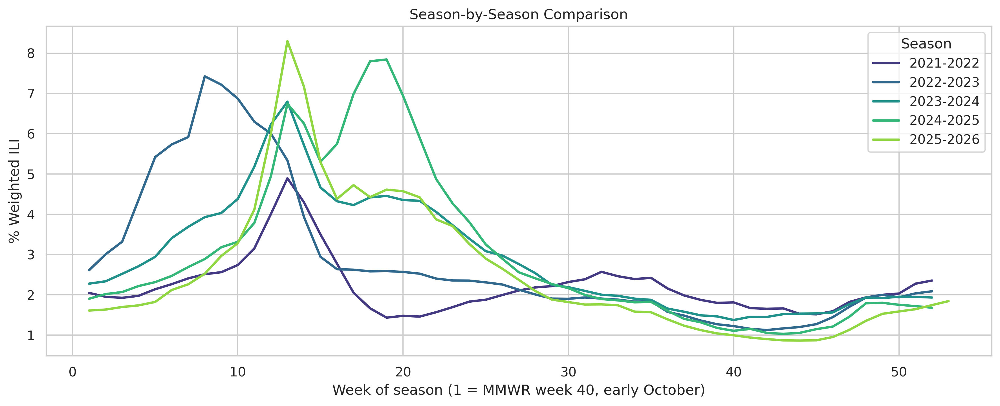
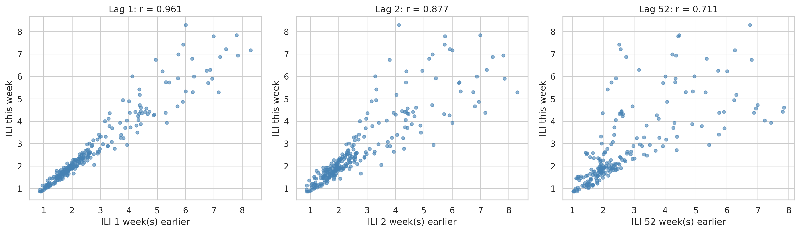
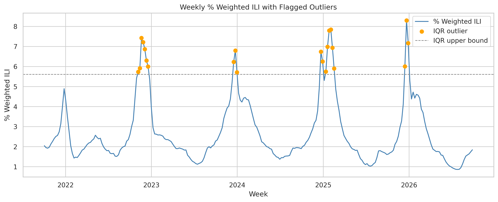

# Data

This folder contains the data used in Forecasting Weekly Influenza-Like Illness Visits (The Pink Tigers — DS 4002, Project 2).
### Raw Data
| File | Description |
|---|---|
| `MET_paintings_rawdata` | We built the dataset with a Python script that utilizes The Met Collection API. The script searches the Met’s European Paintings department for works that have images and requests each work’s record. It keeps only paintings marked as public domain and dated between 1600 and 1899, downloads each painting’s main image, and writes the information to the CSV. |

### Final analysis data CHANGE

The final data analyzed are generated from the raw files above by SCRIPTS/ds_4002_project_2.ipynb. Copies are stored in this folder and are identical to the files the notebook writes to OUTPUT/:

| File | Description |
|---|---|
| `DATA/model_training_data.csv` | Cleaned 2021–2025 training data (208 weeks) used for model development. Columns: `Date` (Sunday that begins the MMWR week), `Year`, `Week`, `Weighted_ILI_Percent`, and holiday indicators `Thanksgiving`, `Christmas`, `New_Year` (1 = the week contains that holiday, 0 = otherwise). |
| `DATA/model_test_predictions.csv` | The 2025–2026 test season (53 weeks) as analyzed: `Date`, observed weighted ILI (`Actual`), model and previous-week baseline predictions, and their absolute errors. |

## Data Summary

The dataset contains about 200 public-domain European paintings from The Metropolitan Museum of Art. They are split roughly evenly across the 17th, 18th, and 19th centuries, with about 66 paintings each. The first part is a folder of painting images and the second is a CSV file with one row per painting. These files will be uploaded using the script. We built the dataset with a Python script that utilizes The Met Collection API. The script searches the Met’s European Paintings department for works that have images and requests each work’s record. It keeps only paintings marked as public domain and dated between 1600 and 1899, downloads each painting’s main image, and writes the information to the CSV which will be uploaded to our GitHub for anyone to access.

## Provenance
The dataset was constructed using the Met’s open access database. It is a collection of images and data about art pieces in The Met collection. Since 2017, the Met’s Open Access program has made images of its public-domain artworks and basic data on its collection freely available. The museum shares this material through its public Collection API. The century labels come from the museum’s dates, and many of those are estimates (for example, “ca. 1650”), so the labels are approximate.

## License
For our project, we identify the Met as the data source. We use the Met’s open access initiative which made their images of public-domain artworks and basic data on all accessioned works in its collection available for unrestricted use under Creative Commons Zero (CC0). This allows us to download and share the images and data of the Met’s artworks. 

## Ethical Statement
This project only uses images and data from the MET that was released into the public domain through its Open Access program. This ensures that no copyrighted material or personal data is involved. We will follow the Met’s API terms of use by crediting the museum as the data source. Our model’s conclusions apply only to this narrow collection of artwork. The dating comes from museum records and some data are rough estimates. Therefore, we will treat these labels as approximate. The model is not meant to authenticate artworks in practice where errors could have financial or academic consequences. 

## Data Dictionary CHANGE

| Name | Type | Definition | Uncertainty |
|------|------|------------|-------------|
| `REGION TYPE` | text | Geographic area; `National` for every row in this project | N/A |
| `REGION` | text | Sub-region name (HHS region, state). For national data every value is `X`, a CDC placeholder meaning not applicable | N/A |
| `YEAR` | integer | Year of the MMWR week | N/A |
| `WEEK` | integer | MMWR surveillance week number (1–53); combined with `YEAR` to date each observation | N/A |
| `% WEIGHTED ILI` | percentage | ILI visits as % of all visits, weighted by state population so large states count proportionally | CDC does not publish a confidence interval. The most recent weeks can be revised as late reports come in. |
| `%UNWEIGHTED ILI` | percentage | `ILITOTAL` ÷ `TOTAL PATIENTS` × 100, no weighting | True uncertainty is larger because visits cluster within providers. |
| `AGE 0-4` | integer | Number of ILI visits, ages 0–4 | Age is recorded by the provider; only a small share of visits may have an unknown age. |
| `AGE 25-49` | integer | Number of ILI visits, ages 25–49 | Same as `AGE 0-4`. |
| `AGE 25-64` | text | Legacy age band used by CDC before the 2009–10 season. Every value in these files is `X` (not applicable) | This band was replaced by `AGE 25-49` and `AGE 50-64`. |
| `AGE 5-24` | integer | Number of ILI visits, ages 5–24 | This age range can be sensitive to school calendars because visits drop during holiday breaks. |
| `AGE 50-64` | integer | Number of ILI visits, ages 50–64 | Same as `AGE 0-4`. |
| `AGE 65` | integer | Number of ILI visits, ages 65 and older | Same as `AGE 0-4`. |
| `ILITOTAL` | integer | Total ILI visits, all ages | This count is dependent on how many providers reported that week. |
| `NUM. OF PROVIDERS` | integer | Sentinel providers that reported that week | The network grew about 22% during the set time period and jumps each October when providers re-enrol, so patient mix may shift between seasons. |
| `TOTAL PATIENTS` | integer | All outpatient visits (any reason) at reporting providers | Drops in holiday weeks (e.g. Thanksgiving), which can make % ILI look higher than it is. |
## Explanatory Plots CHANGE

### Seasonal pattern across influenza seasons

The weighted ILI percentage follows a strong recurring seasonal pattern. All five seasons rise during the fall and winter, reach their highest levels near the middle of the influenza season, and then decline through spring and summer. However, the timing and height of the peak vary substantially. For example, the 2022–2023 season peaks earlier, while the 2023–2024 season reaches a later elevated period. This variation shows why the model must use recent weekly observations instead of assuming that every season has an identical curve.

### Relationship with previous weeks

Weighted ILI is strongly related to its recent history. The lag-1 correlation is 0.961 and the lag-2 correlation is 0.877, showing that adjacent weeks tend to have similar values. The lag-52 correlation is also positive at 0.711, which provides evidence of an annual seasonal pattern. These findings support the use of autoregressive forecasting models and justify comparing model forecasts with a previous-week naive baseline.

### High-value weeks and seasonal peaks

The IQR rule flags observations above approximately 5.6% weighted ILI as statistical outliers. These points are concentrated around winter peaks rather than scattered randomly through time. They therefore appear to represent genuine high-influenza periods, not obvious data-entry errors. The observations were retained so that the model could learn the full magnitude of seasonal outbreaks.

### Additional exploratory finding

The distribution of weighted ILI is right-skewed because most weeks have relatively low values and a smaller number of winter weeks have much higher values. A log transformation makes the distribution more symmetric, but the time-series and lag plots show that dependence across weeks remains the most important feature for forecasting. For that reason, the final analysis models the original weighted ILI percentage with ARIMA and ARIMAX specifications while evaluating forecasts using MAE, which is less sensitive to extreme errors than squared-error metrics.
