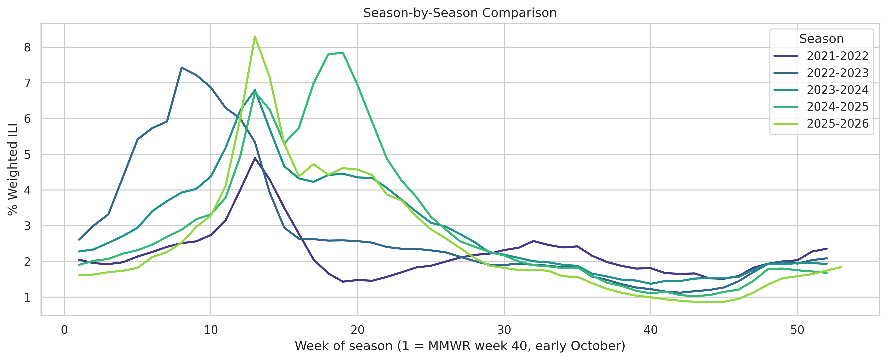
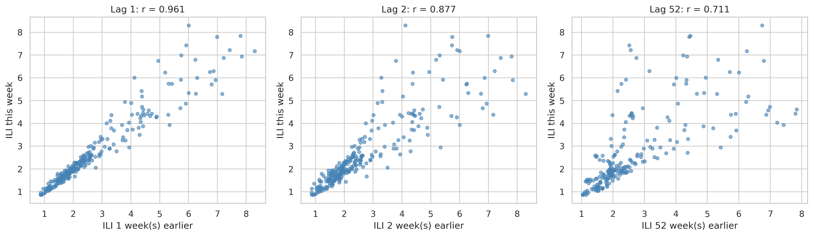
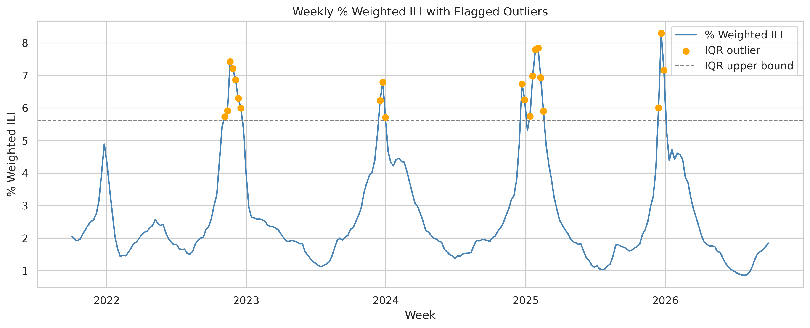

# Data

This folder contains the data used in Forecasting Weekly Influenza-Like Illness Visits (The Pink Tigers — DS 4002, Project 2).

| File | Description |
|---|---|
| `Influenza_Data_21-25.csv` | The raw csv file downloaded from the CDC page including data from 2021-2022, 2022-2023, 2023-2024, and 2024-2025 files of Influenza Data consolidated when downloaded from the website. |
| `Influenza_Data_25-26.csv` | The raw csv file downloaded from the CDC page including data from 2025-2026 of Influenza Data. |

### Final analysis data

The final data analyzed are generated from the raw files above by SCRIPTS/ds_4002_project_2.ipynb. Copies are stored in this folder and are identical to the files the notebook writes to OUTPUT/:

| File | Description |
|---|---|
| `DATA/model_training_data.csv` | Cleaned 2021–2025 training data (208 weeks) used for model development. Columns: `Date` (Sunday that begins the MMWR week), `Year`, `Week`, `Weighted_ILI_Percent`, and holiday indicators `Thanksgiving`, `Christmas`, `New_Year` (1 = the week contains that holiday, 0 = otherwise). |
| `DATA/model_test_predictions.csv` | The 2025–2026 test season (53 weeks) as analyzed: `Date`, observed weighted ILI (`Actual`), model and previous-week baseline predictions, and their absolute errors. |

## Data Summary

The data are weekly national counts from the CDC's Outpatient Influenza-like Illness Surveillance Network (ILINet), downloaded through FluView Interactive. They cover five influenza seasons, from 2021–2022 through 2025–2026, split across two raw CSV files. Each row is one MMWR week. It records the number of reporting sentinel providers, total outpatient visits, influenza-like illness (ILI) visits overall and by age group, and the weighted and unweighted percentage of visits that were for ILI.

The main variable for this project is `% WEIGHTED ILI`, which is the national ILI percentage weighted by state population. It follows a strong seasonal cycle, peaking each winter, with peak timing and height that vary from season to season. The other columns give context, such as provider participation and patient volume, and allow breakdowns by age.

## Provenance
This dataset comes from the Centers for Disease Control and Prevention (CDC) through the United States Outpatient Influenza-like Illness Surveillance Network (ILINet). This is created as a secondary data source because it is not directly from patients but instead based on existing records. It was created by receiving weekly counts of total patient visits as well as influenza-like illness visits, defined as fever accompanied by cough or sore throat, from participating outpatient healthcare providers. The CDC compiles these reports and calculates the national percentage of visits for influenza-like illness, weighting each state’s contribution by its population. We accessed these data through an interactive dashboard on the CDC website called FluView Interactive to select national weekly observations from 2021-2026. 

## License

For our project, we identify the CDC as the data source, distinguishing our analysis from the original data. We use the CDC general public-domain reuse policy for the ILINet data that we are accessing through FluView Interactive. The policy states users are to credit the CDC and state that the original material is available for free on its website while preserving the substantive content and clarifying that reuse does not imply CDC endorsement. Our project is not directly connected or endorsed by the CDC.

## Ethical Statement
The data are public, aggregated and de-identified, so the privacy risk to individuals is very low. The main ethical risks are in how results are interpreted. Records are national weekly totals with no patient or provider identifiers. No attempt should be made to link these totals to other data to identify people or clinics. Sentinel providers volunteer and are not a random sample. Rural areas, uninsured people, and people who avoid or cannot reach outpatient care (e.g. due to cost, language or immigration concerns) are likely under-represented. Results should not be presented as the experience of every community. Differences across age groups partly reflect who visits a doctor, not only who gets sick. This is descriptive surveillance data, not a forecast or a measure of severity. It should not be used alone for individual medical decisions.

## Data Dictionary

| Name | Type | Definition | Uncertainty |
|------|------|------------|-------------|
| `REGION TYPE` | text | Geographic area; `National` for every row in this project | N/A |
| `REGION` | text | Sub-region name (HHS region, state). For national data every value is `X`, a CDC placeholder meaning not applicable | N/A |
| `YEAR` | integer | Year of the MMWR week | N/A |
| `WEEK` | integer | MMWR surveillance week number (1–53); combined with `YEAR` to date each observation | N/A |
| `% WEIGHTED ILI` | percentage | ILI visits as % of all visits, weighted by state population so large states count proportionally | CDC does not publish a confidence interval. The most recent weeks can be revised as late reports come in. |
| `%UNWEIGHTED ILI` | percentage | `ILITOTAL` ÷ `TOTAL PATIENTS` × 100, no weighting | True uncertainty is larger because visits cluster within providers. |
| `AGE 0-4` | integer | Number of ILI visits, ages 0–4 | Age is recorded by the provider; only a small share of visits may have an unknown age. |
| `AGE 25-49` | integer | Number of ILI visits, ages 25–49 | Same as `AGE 0-4`. |
| `AGE 25-64` | text | Legacy age band used by CDC before the 2009–10 season. Every value in these files is `X` (not applicable) | This band was replaced by `AGE 25-49` and `AGE 50-64`. |
| `AGE 5-24` | integer | Number of ILI visits, ages 5–24 | This age range can be sensitive to school calendars because visits drop during holiday breaks. |
| `AGE 50-64` | integer | Number of ILI visits, ages 50–64 | Same as `AGE 0-4`. |
| `AGE 65` | integer | Number of ILI visits, ages 65 and older | Same as `AGE 0-4`. |
| `ILITOTAL` | integer | Total ILI visits, all ages | This count is dependent on how many providers reported that week. |
| `NUM. OF PROVIDERS` | integer | Sentinel providers that reported that week | The network grew about 22% during the set time period and jumps each October when providers re-enrol, so patient mix may shift between seasons. |
| `TOTAL PATIENTS` | integer | All outpatient visits (any reason) at reporting providers | Drops in holiday weeks (e.g. Thanksgiving), which can make % ILI look higher than it is. |
## Explanatory Plots

### Seasonal pattern across influenza seasons

The weighted ILI percentage follows a strong recurring seasonal pattern. All five seasons rise during the fall and winter, reach their highest levels near the middle of the influenza season, and then decline through spring and summer. However, the timing and height of the peak vary substantially. For example, the 2022–2023 season peaks earlier, while the 2023–2024 season reaches a later elevated period. This variation shows why the model must use recent weekly observations instead of assuming that every season has an identical curve.

### Relationship with previous weeks

Weighted ILI is strongly related to its recent history. The lag-1 correlation is 0.961 and the lag-2 correlation is 0.877, showing that adjacent weeks tend to have similar values. The lag-52 correlation is also positive at 0.711, which provides evidence of an annual seasonal pattern. These findings support the use of autoregressive forecasting models and justify comparing model forecasts with a previous-week naive baseline.

### High-value weeks and seasonal peaks

The IQR rule flags observations above approximately 5.6% weighted ILI as statistical outliers. These points are concentrated around winter peaks rather than scattered randomly through time. They therefore appear to represent genuine high-influenza periods, not obvious data-entry errors. The observations were retained so that the model could learn the full magnitude of seasonal outbreaks.

### Additional exploratory finding

The distribution of weighted ILI is right-skewed because most weeks have relatively low values and a smaller number of winter weeks have much higher values. A log transformation makes the distribution more symmetric, but the time-series and lag plots show that dependence across weeks remains the most important feature for forecasting. For that reason, the final analysis models the original weighted ILI percentage with ARIMA and ARIMAX specifications while evaluating forecasts using MAE, which is less sensitive to extreme errors than squared-error metrics.
